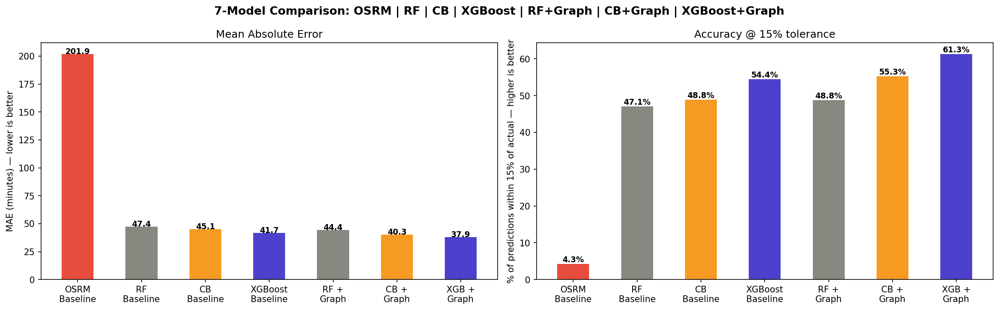

# Graph ETA Prediction

> Predicting delivery ETAs using graph analytics and network intelligence for smarter logistics operations.

---

## Table of Contents

- [Overview](#overview)
- [Project Structure](#project-structure)
- [Pipeline Architecture](#pipeline-architecture)
- [Models](#models)
- [Results](#results)
- [Key Outputs](#key-outputs)
- [Getting Started](#getting-started)
- [Running the App](#running-the-app)
- [Tech Stack](#tech-stack)
- [Live App](#live-app)

---

## Overview

Standard ETA engines (like OSRM) estimate delivery time based purely on road distance and speed — they ignore real-world network congestion, hub inefficiencies, and historical delay patterns.

This project builds a **graph-based intelligence layer** on top of raw delivery data to:

- Model the entire logistics network as a directed graph (hubs as nodes, corridors as edges)
- Compute structural hub metrics: betweenness centrality, PageRank, clustering coefficient
- Generate 20-dimensional graph embeddings per hub encoding delay behaviour and network position
- Train and compare four ML models — with and without graph features — to predict actual delivery time
- Identify bottleneck hubs, SLA breach corridors, and quantify revenue at risk

---

## Project Structure

```
Graph_ETA_Prediction/
│
├── Dataset/
│   └── delivery_data.csv               # Raw delivery trip data
│
├── plots/                              # All generated charts
│   ├── bottleneck_hubs.png             # Top 10 hubs by SLA breach volume and centrality
│   ├── network_graph.png               # Network visualization of top 50 hubs
│   ├── delay_analysis.png              # Delay ratio by route type and time of day
│   ├── model_comparison.png            # MAE and 15%-accuracy across all models
│   ├── xgb_baseline_importance.png     # Feature importance: XGBoost baseline
│   ├── xgb_graph_importance.png        # Grouped feature importance: XGBoost + Graph
│   ├── rf_graph_importance.png         # Grouped feature importance: RF + Graph
│   ├── cb_graph_importance.png         # Grouped feature importance: CatBoost + Graph
│   └── ftl_carting_tradeoff.png        # FTL vs Carting delay comparison by risk tier
│
├── app_data/                           # Auto-generated after pipeline run
│   ├── audit_df.csv                    # Hub-level audit with risk tiers
│   ├── corridors_df.csv                # Corridor-level delay stats
│   ├── top_breach_corridors.csv        # Top 20 chronic delay corridors
│   ├── revenue_risk.csv                # Revenue at risk by segment
│   ├── results.pkl                     # All model metrics and memo
│   ├── xgb_graph_model.pkl             # Best trained model
│   ├── enhanced_features.pkl           # Feature list for inference
│   ├── embeddings.pkl                  # Hub graph embeddings
│   └── le_time.pkl                     # Time-of-day label encoder
│
├── Graph_ETA_Prediction_Full_Pipeline.ipynb   # Main analysis notebook
├── App.py                                     # Streamlit dashboard
└── requirements.txt                           # Python dependencies
```

---

## Pipeline Architecture

```
Raw CSV
   │
   ▼
Data Cleaning & Time Feature Extraction
   │
   ▼
Trip Leg Aggregation → Corridor Stats (delay ratio, p90, volume)
   │
   ▼
Directed Graph Construction (NetworkX)
   │
   ▼
Graph Metrics (betweenness, PageRank, clustering, degree)
   │
   ▼
Hub Risk Audit → SLA Breach Detection → Revenue Impact
   │
   ▼
32-dim Graph Embeddings per Hub
   │
   ▼
ML Training (RF / XGBoost × Baseline / Graph-Enhanced)
   │
   ▼
Model Comparison + Business Recommendations + Strategy Memo
```

---

## Models

Four models are trained and compared on **MAE** (Mean Absolute Error in minutes) and **15%-Accuracy** (% of predictions within 15% of actual time):

| Model | Features Used |
|---|---|
| Random Forest Baseline | OSRM time, distance, route type, time features |
| XGBoost Baseline | Same as above |
| Random Forest + Graph | Baseline + 20-dim source & destination hub embeddings |
| XGBoost + Graph | Same graph-enhanced feature set |

Graph embeddings encode: betweenness centrality, PageRank, in/out degree, clustering coefficient, outbound/inbound delay mean, max, std, p90, and interaction terms.

---

## Results

| Model | MAE (min) ↓ | R² ↑ | 15%-Accuracy ↑ |
|---|---|---|---|
| OSRM (reference) | 201.90 | 0.6386 | 4.3% |
| Random Forest Baseline | 47.40 | 0.9772 | 47.1% |
| Random Forest + Graph | 44.43 | 0.9805 | 48.8% |
| CatBoost Baseline | 45.15 | 0.9797 | 48.8% |
| CatBoost + Graph | 40.31 | 0.9837 | 55.3% |
| XGBoost Baseline | 41.65 | 0.9809 | 54.4% |
| **XGBoost + Graph** | **37.89** | **0.9831** | **61.3%** |
| Ensemble (RF+Graph, CB+Graph, XGB+Graph) | 38.64 | 0.9843 | 55.6% |

- **XGBoost + Graph** is the best model, with an MAE of **37.89 min** and **61.3%** accuracy within 15%
- Graph embeddings improved every model: Random Forest (−2.97 min), CatBoost (−4.84 min), XGBoost (−3.76 min)
- The best model improves on raw OSRM by **81.2%** (MAE 201.90 → 37.89 min)



---

## Key Outputs

| File | Description |
|---|---|
| `bottleneck_hubs.png` | Top 10 hubs by SLA breach volume and centrality |
| `network_graph.png` | Network visualization of top 50 hubs |
| `delay_analysis.png` | Delay ratio by route type and time of day |
| `model_comparison.png` | MAE and 15%-accuracy across all four models |
| `xgb_graph_importance.png` | Grouped feature importance for best model |
| `ftl_carting_tradeoff.png` | FTL vs Carting delay comparison by risk tier |
| `strategy_memo.txt` | Auto-generated ops strategy memo with findings |

---

## Getting Started

**1. Clone the repository**

```bash
git clone https://github.com/your-username/Graph_ETA_Prediction.git
cd Graph_ETA_Prediction
```

**2. Install dependencies**

```bash
pip install -r requirements.txt
```

**4. Run the notebook**

Open and run all cells in `Graph_ETA_Prediction_Full_Pipeline.ipynb` top to bottom. All outputs, models, and the strategy memo will be saved automatically.

---

## Running the App

Once the notebook has been run and `app_data/` is populated:

```bash
streamlit run App.py
```

---

## Tech Stack

| Library | Purpose |
|---|---|
| `pandas` | Data loading, cleaning, aggregation |
| `numpy` | Numerical operations and embedding math |
| `networkx` | Graph construction and centrality metrics |
| `scikit-learn` | Random Forest, Decision Tree, preprocessing, evaluation |
| `xgboost` | Gradient boosting models |
| `matplotlib` | All charts and network visualizations |
| `streamlit` | Interactive dashboard (`App.py`) |

## Live App
**[Try the live app →](https://delhiveryeta2026.streamlit.app/)**
